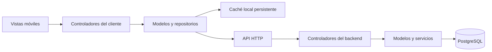

# Plan de implementación de VIMO

> Para el estado de implementación y las verificaciones realizadas, consultar [Avances](docs/AVANCES.md). Las casillas finales representan aceptación completa; el contenido oficial y la validación en PostgreSQL y dispositivos continúan pendientes.

## Objetivo

Completar el prototipo de VIMO (Violeta Móvil) hasta convertirlo en una aplicación móvil de consulta que permita buscar cartas, apoyar la planificación de partidas y explorar la historia de personajes, enemigos e infraestructura del juego.

El público objetivo son jugadores que requieren información para desarrollar estrategias y personas interesadas en la historia del juego.

## 1. Alcance y criterios de aceptación

El recorrido principal comienza en una pantalla de inicio con accesos a **Base de datos de cartas** y **Archivos lore**. Durante una partida de PC, el jugador introduce en el móvil el ID visible de cuatro dígitos de una carta y consulta su efecto y estadísticas mediante una coincidencia exacta, conservando ceros iniciales. Fuera del combate puede explorar personajes, enemigos e instalaciones. Ver [recorridos e ilustraciones descritas](docs/RECORRIDOS_USUARIO.md).

| Módulo | Funciones requeridas | Criterio de aceptación |
| --- | --- | --- |
| Buscador de cartas | Buscar por nombre, descripción, efecto y etiquetas; consultar información detallada. | Todas las cartas del catálogo aprobado pueden encontrarse y presentan información suficiente para apoyar decisiones de juego. |
| Guía del juego | Navegar entre personajes, enemigos e infraestructura; consultar descripción e historia. | Las tres secciones contienen información real y validada del juego. |
| Consulta rápida | Reutilizar información mediante caché y comunicar estados de carga, error y datos desactualizados. | Las consultas repetidas evitan solicitudes innecesarias y el contenido previamente descargado puede consultarse sin conexión. |

Antes de cargar contenido, identificar la fuente oficial del juego y aprobar un inventario de cartas, personajes, enemigos e instalaciones. Los datos de ejemplo se conservarán únicamente para desarrollo y pruebas.

## 2. Arquitectura propuesta

- Cliente móvil: React Native, Expo y Expo Router.
- Backend: Node.js y TypeScript.
- Base de datos: PostgreSQL.
- Arquitectura: cliente-servidor con separación de responsabilidades MVC.



### Responsabilidades

- **Vistas:** presentan contenido y reciben acciones del usuario.
- **Controladores del cliente:** coordinan búsquedas, cargas y estados de la interfaz.
- **Modelos y repositorios:** representan entidades, validan datos y deciden entre caché y API.
- **Controladores del backend:** validan solicitudes y coordinan las respuestas.
- **Modelos y servicios del backend:** aplican reglas de consulta y acceden a la base de datos.
- **Servicio de base de datos:** utiliza una instancia compartida por proceso que administra un pool de conexiones.

### Patrón singleton

El backend centralizará el acceso a la base de datos mediante una instancia compartida del servicio, evitando recreaciones innecesarias y gestionando la reutilización de conexiones.

El singleton no garantiza consumo nulo de RAM ni baja latencia por sí mismo. El backend, las conexiones y la caché consumen memoria; su comportamiento deberá medirse.

## 3. Fases de implementación

| Fase | Trabajo | Entregable y condición de cierre |
| --- | --- | --- |
| 1. Preparación | Revisar la versión de Expo y su documentación; diagnosticar dependencias; corregir lint; unificar la versión inicial; documentar estructura y comandos. | Proyecto reproducible con lint y TypeScript aprobados. |
| 2. Datos y contrato de API | Definir campos, relaciones, búsquedas, paginación, respuestas y errores; aprobar el catálogo y sus fuentes. | Modelo de datos, migraciones iniciales y contrato de API documentado. |
| 3. Backend MVC | Implementar servidor, controladores, modelos, repositorios y servicio singleton de base de datos; cargar contenido validado. | API consultable con pruebas de integración y conexión real a PostgreSQL. |
| 4. Integración móvil | Conectar repositorios del cliente con la API; utilizar los modelos existentes; retirar el reemplazo silencioso por datos ficticios. | Pantallas con datos del servidor y errores comprensibles. |
| 5. Funcionalidades y contenido | Completar búsqueda, detalle de cartas y navegación por la guía; incorporar el catálogo aprobado. | Recorridos funcionales completos con contenido real. |
| 6. Caché y rendimiento | Incorporar almacenamiento persistente, caducidad, actualización e invalidación; optimizar listas y solicitudes. | Consulta sin conexión de datos descargados y mediciones de tiempos de respuesta. |
| 7. Calidad y publicación | Ejecutar pruebas en Android e iOS, validar accesibilidad, preparar builds con EAS y completar documentación. | Versión candidata aprobada, build instalable y etiqueta de versión. |

## 4. Implementación del backend

### API mínima

| Método y ruta | Propósito |
| --- | --- |
| `GET /api/v1/cards` | Listar cartas con búsqueda y paginación. |
| `GET /api/v1/cards/:id` | Obtener el detalle de una carta. |
| `GET /api/v1/characters` | Listar personajes. |
| `GET /api/v1/characters/:id` | Consultar descripción, historia y relaciones. |
| `GET /api/v1/enemies` | Listar enemigos. |
| `GET /api/v1/enemies/:id` | Consultar información e historia de un enemigo. |
| `GET /api/v1/infrastructure` | Listar instalaciones o lugares. |
| `GET /api/v1/infrastructure/:id` | Consultar información e historia de una instalación. |

### Reglas de implementación

- Asignar identificadores estables y fechas de actualización a las entidades.
- Validar parámetros y limitar el tamaño de página.
- Utilizar consultas parametrizadas y errores consistentes.
- Mantener credenciales y secretos exclusivamente en el servidor.
- Configurar la dirección pública de la API en el cliente.
- Documentar migraciones y carga del catálogo.
- Verificar el estado HTTP y la estructura de las respuestas en el cliente.
- No sustituir silenciosamente errores del servidor por contenido ficticio.

## 5. Implementación móvil

Mantener las rutas dentro de `src/app/` y los componentes, controladores, modelos y servicios fuera de ese directorio.

### Buscador de cartas

- Búsqueda sin distinguir mayúsculas y con tratamiento consistente de espacios y acentos.
- Resultados con nombre, tipo, costo, rareza y efecto.
- Pantalla de detalle con descripción completa y etiquetas.
- Estados de carga, búsqueda sin resultados, error y reintento.
- Protección frente a respuestas antiguas que lleguen después de una búsqueda nueva.

### Guía del juego

- Secciones de personajes, enemigos e infraestructura.
- Listados eficientes y pantallas de detalle.
- Historia, descripción y relaciones disponibles en el catálogo.
- Enlaces a cartas relacionadas cuando corresponda.

### Experiencia móvil

- Respetar áreas seguras y comportamiento del teclado.
- Permitir texto escalable y proporcionar etiquetas de accesibilidad.
- Utilizar controles táctiles adecuados y listas virtualizadas para catálogos extensos.
- Validar la interfaz y los recorridos en Android e iOS.

## 6. Estrategia de caché

| Nivel | Uso |
| --- | --- |
| Memoria | Resolver rápidamente consultas repetidas durante la sesión. |
| Almacenamiento persistente | Conservar catálogos y detalles descargados entre aperturas. |

### Comportamiento

1. Mostrar el contenido almacenado cuando esté disponible.
2. Consultar el servidor cuando el contenido haya caducado.
3. Actualizar la interfaz y la caché con una respuesta válida.
4. Conservar la última versión válida ante fallos de red e indicar que se está mostrando información guardada.
5. Ofrecer reintento y actualización manual.

Los tiempos actuales de caducidad —cinco minutos para catálogos y un minuto para búsquedas— servirán como punto de partida y se ajustarán según la frecuencia de actualización del contenido.

Evitar solicitudes simultáneas duplicadas, limitar el almacenamiento y definir reglas de invalidación.

### Objetivos iniciales de rendimiento

- Mostrar contenido en caché en menos de 300 ms.
- Obtener respuestas de consulta del backend en menos de 500 ms en el percentil 95, bajo un entorno de prueba documentado.

Estos valores son objetivos propuestos y deberán medirse antes de declarar su cumplimiento.

## 7. Git Flow y SemVer

### Ramas

| Rama | Uso |
| --- | --- |
| `main` | Versiones estables aprobadas. |
| `develop` | Integración del trabajo de desarrollo. |
| `feature/nombre-funcionalidad` | Implementación de funcionalidades. |
| `bugfix/nombre-correccion` | Correcciones durante desarrollo. |
| `release/0.1.0` | Preparación y validación de una versión. |
| `hotfixes/nombre-correccion` | Correcciones urgentes de producción. |

Usar `main` como rama estable, tras renombrar la rama local `master`. Integrar cambios mediante pull requests con revisión y comprobaciones automáticas. Crear ramas de corrección y liberación cuando el proceso las requiera. Seguir las reglas detalladas en `docs/VERSIONAMIENTO.md`.

Las correcciones de producción deberán reincorporarse a `develop` para evitar que se pierdan en versiones posteriores.

### Versionamiento

- Unificar inicialmente `package.json` y `app.json` en `0.1.0`.
- Utilizar `0.x.y` durante el desarrollo previo a la primera versión estable.
- Publicar `1.0.0` cuando el alcance aprobado esté completo.
- Aplicar incrementos major, minor y patch según compatibilidad, nuevas funciones y correcciones.
- Crear etiquetas con prefijo `v`, como `v0.1.0` y `v1.0.0`.
- Mantener un registro de cambios y números de compilación de Android e iOS.

## 8. Entorno Expo y comandos

Antes de modificar APIs de Expo, EAS o React Native:

1. Leer la versión mayor de `expo` en `package.json`.
2. Consultar `https://docs.expo.dev/versions/v<major>.0.0/`.
3. Para otros temas, consultar `https://docs.expo.dev/llms.txt` y seguir los enlaces pertinentes.

Utilizar `expo install` para instalar dependencias compatibles. Si existe `bun.lock`, sustituir `npx` por `bunx`; para EAS utilizar `bunx eas-cli`.

```bash
npx expo install <paquete>
npx expo start
npx expo lint
npx tsc --noEmit
npx expo-doctor
```

Configurar el comportamiento nativo mediante la configuración de Expo y plugins. No crear ni editar manualmente directorios nativos generados bajo Continuous Native Generation.

Cuando se agreguen módulos nativos no incluidos en Expo Go, generar un development build. Preparar compilaciones, firma y envío mediante EAS:

```bash
npx eas-cli@latest build --profile development
npx eas-cli@latest build --profile production
npx eas-cli@latest submit
```

## 9. Verificación y entrega

La integración continua ejecutará lint, TypeScript y las pruebas relevantes.

### Cobertura de validación

- Búsquedas por los campos acordados y consultas sin resultados.
- Navegación y detalle de las tres secciones de la guía.
- API, validación de parámetros y acceso a la base de datos.
- Caché vigente, caducada, persistente y sin conexión.
- Errores HTTP, respuestas inválidas y recuperación de la red.
- Instalación y recorridos principales en Android e iOS.
- Medición de rendimiento bajo condiciones documentadas.

### Entregables

- Código fuente del cliente y del backend.
- Migraciones y catálogo validado.
- Documentación de arquitectura y contrato de API.
- Instrucciones de configuración y ejecución.
- Resultados de pruebas y mediciones de rendimiento.
- Registro de cambios, etiquetas y evidencia del flujo de integración.
- Builds generados con EAS.

## 10. Definición de terminado

- [ ] El buscador permite encontrar todas las cartas del catálogo aprobado.
- [ ] Los detalles de cartas contienen información real y suficiente.
- [ ] Personajes, enemigos e infraestructura tienen contenido validado.
- [ ] El cliente utiliza una API real conectada a PostgreSQL.
- [ ] Los modelos participan en el flujo de datos y las responsabilidades MVC están documentadas.
- [ ] El backend utiliza un servicio singleton de base de datos con pool de conexiones.
- [ ] La caché en memoria y persistente funciona y permite consultar datos descargados sin conexión.
- [ ] Los estados de carga, error, datos guardados y reintento son comprensibles.
- [ ] Los objetivos de rendimiento están medidos y sus resultados documentados.
- [ ] Lint, TypeScript y las pruebas relevantes están aprobados.
- [ ] Los recorridos principales se validaron en Android e iOS.
- [ ] Las versiones están alineadas y existe una etiqueta Git con prefijo `v`.
- [ ] La documentación permite reproducir la configuración y generar una compilación.
- [ ] Existe una versión candidata aprobada y un build instalable.
